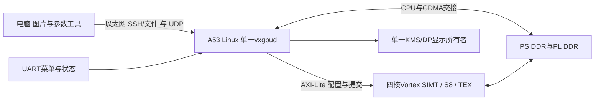

# 系统架构与数据流

CPU负责输入、模型管理、调度、部分GELU/GN统计及结果呈现。PL负责可编程并行计算和矩阵/纹理任务。控制和数据地址域分别管理。每请求绑定模型/程序/输入/owner/epoch；完成必须同时满足DONE、错误检查、ACK、排空与可证明退休。

HUNet按ROI分类，输出8105类raw logits；R13有baseline、GN9和GN16独立策略。Mosaic为固定风格的16层网络，R13使用v8程序及47节点融合图，保留15次全图统计和5份FP32残差。P8处理三器物、UV/深度和纹理显示；只有完全结束的请求或帧才能交接设备。

软件路径：PC tools → unified控制服务 → nnrt/P8适配 → 驱动/ioctl → AXI/CDMA/GPU → ResultStore/图像 → KMS/DP。完整模型、结果文件和纹理桥分别保留来源，图片收到不等于GPU推理通过。
