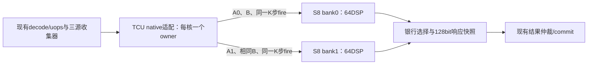

# 每核双S8共享B、全GPU八套阵列设计规格

2026-10-18，IC/FPGA，`DESIGN_REVIEW_REQUIRED`。用户授权本轮完成设计和实施计划，尚未批准以下具体编码或启动实现。根目录：`F:/obsidian-codex/codex/work/mosaic_tcu_dual_s8_shared_b_20261018_v1`，下文路径均相对此根。

## 1. 目标、取舍与成功标准

在现有W4四核GPU上，每核由一个S8扩展到两个S8，两个8×8阵列共享每个K步骤的B[8]，分别消费A0[8]/A1[8]，形成16×8的有效输出块。全GPU八套、512个原生INT16 PE；每核仍一个owner上下文，共四个独立作业上下文。保持现有host驱动、runtime API/ABI、加载与启动、寄存器文件、scoreboard/issue、LSU/cache/AXI、GPU及PS/PL外部连接、时钟/复位和旧格式数值语义。

选定方案是耦合双阵列共享B。另两条路线作为取舍记录：两套独立上下文需要更多仲裁、结果生命周期和512bit/步输入，不采用；恢复旧N16-S16的descriptor/loader方案涉及更大访存改造，不采用。旧S16只证明512PE规模曾被设计，不能继承其ABI、实现或性能结论。

成功必须分别证明：旧路径兼容、双阵列精确功能、真实设备指令及四核工作、实际周期/供数行为、综合八阵列映射、实际布局布线与物理审计。不得把“资源可放下”当功能通过，也不保证整网两倍加速。本次设计记录不等于任何候选PASS。

## 2. 冻结来源与不变边界

直接比较基线是现有四套S8/W4交付源码，不是更早没有S8的W4。上游：`F:/obsidian-codex/codex/work/mosaic_tcu_s8_w4_gpu_physical_20261015_v1`，W4来源ID `HUNET_HW4_AXI_W4_20261015_faeaddb98d5d`。

- `reference/s8_w4/`的306文件由上游`evidence/source_rebase_manifest.json.candidate_files`逐项SHA验证；包含198项compat RTL及板级/构建配置。没有复制历史run作为新run。
- 源码/控制历史摘要708bfd8bd611beb9631cf8294e191cf57d1a6a48c777cea7d9f42b8a27c51a7d只说明上游身份，本工程会形成自己的源码/工具/合同摘要。
- 四套bit SHA：94ae9d3e6eb73ba55a8eec8c802e3818cd6b3a9be7e60542da5ae9459e3579e1；XSA SHA：02e68160e21b01621fde1eac6e472810e0fe50cd1842acb3ab63469314355e94。两者本轮已只读重核，均不含八套。
- 上游routed DCP SHA：f550075ce584a2d2af606ff11e048d0a64c25962aa23e50e37430b4061839439，仅作为历史参照；八套必须新综合、新实现。
- 上游完整物理签核OPEN_NOT_PASS；时钟请求100MHz/实际配置96.968727MHz、复位输出例外、CDC/DRC与W4既有OPEN原样保留，不移植为PASS。

冻结接口包括execute/result结构、32bit lane/128bit整warp结果、ready/valid/metadata、四核/每核4warp×4lane/RV32、原FP32/FP16/BF16/I8/U8/I4/U4与原S8语义。保留配置中的AXI512、GPU32地址、系统地址和PL-DDR映射、W4写窗口、PS/PL/DDR IP及全部现有XDC；不改变硬件地址空间或驱动寄存器。

可修改产品源码仅候选TCU目录中的`VX_tcu_pkg.sv`、`VX_tcu_uops.sv`、`VX_tcu_native_s8.sv`；新增TCU内部`VX_tcu_s8_pair.sv`与独立设备头/验证程序。`s8_compute.sv`、`VX_tcu_int.sv`仲裁器、旧整数body及非TCU源码保持SHA不变。新增模块由候选build.json增加来源；原sources.tcl保持不变，新仿真/物理flow须显式add_files该pair模块并验证实际编译清单一致，不能只改JSON却漏加Vivado来源。若需要改decode、寄存器文件、scoreboard、issue、LSU/cache、驱动/ABI、外部端口、既有约束或浮点/量化合同，先形成冲突证据和替代设计，停止扩大范围。

## 3. 架构与数值数据流

每核仅两套物理S8。原单S8任务只使用bank0，bank1不接收命令或STEP；双模式原子启动两套，两套同步接受每个K步。不能另保留独立旧S8再加两套，导致每核三套。

新增`VX_tcu_s8_pair.sv`封装两份未改动的`s8_compute`，内部端口为clk/reset、pair_mode、cmd_valid/cmd_ready、k_count[12:0]、step_valid/step_ready、a0_flat/a1_flat/b_flat各128bit、result_valid/result_ready、c0_flat/c1_flat各3072bit、cmd_error。pair_mode由适配器的有效BEGIN选择并保持到释放，活动期不能切换。

BEGIN接受边沿必须使用本次请求的mode，不能误用尚未更新的context寄存器：计算器mode输入选择`active ? context_pair : request_pair`，context_pair在同一有效BEGIN边沿锁存。空闲cmd_ready的判定按待申请模式检查对应一套/两套ready，不能只看旧mode；mode选择不得依赖cmd_valid，以免cmd_valid又依赖cmd_ready形成组合环。命令尚未合法时不得触发任一计算器。

- 单模式：cmd_ready、step_ready、result_valid和c0与原计算器直接对应，不能增加旧路径寄存级或改变旧应答周期。bank1关闭。非法K必须保留原拒绝语义。
- 双模式：cmd_ready=ready0&&ready1；命令fire同时到两套；step_ready=ready0&&ready1，step_fire同时到两套；result_valid=valid0&&valid1，释放同时到两套。任何一侧不可接收时，两侧都不得累加。断言计数相等、完成和模式稳定。
- 两份DSP本地P即两份结果银行，不额外复制整个6144bit到FF银行。响应只锁存选中128bit页和metadata；回压时稳定。
- pipeline、DSP CE和排空使用原`s8_compute`；不声称现有全GPU指令流每周期可发一个STEP。B的扇出翻倍可能影响时序，须由新物理结果回答。

数值：C0[i,j]=sum(k=0..K-1) signed16(A0[i,k])*signed16(B[k,j])；C1同式用A1。初始化为0，K=1..4096，不接受任意初始C、不饱和、不截低32bit。最大绝对和不超过4096×2^30=2^42，容纳于signed48。bank0是输出行0..7，bank1是行8..15，各银行内部8×8行优先。

每lane word的低/高16bit为索引2×lane、2×lane+1。一个双STEP输入A0/B/A1共384bit=48B。M不足16或N不足8时设备端向无效行列显式填0，仍使用完整4lane掩码，不使用部分tmask；K不足4096不补到4096。K>4096不属于本轮硬件命令合同，不能通过跨命令偷偷改变累加语义。

## 4. 明确的新模式编码与旧格式兼容

不新增opcode、funct字段或decode结构。沿用CUSTOM0 0x0b、funct3=0、funct7=2、fmt_s=13/14/15。**在这三个native格式内，把此前被拒绝的fmt_d=3分配为双S8模式标签`TCU_S8_PAIR_ID`**；它不是全局FP或整数数据类型。旧单S8仍fmt_d=8；非native格式对fmt_d的处理完全不变。其他native fmt_d继续BAD_CONTROL。

| 操作 | fmt_s | 单S8 fmt_d | 双S8 fmt_d | 双模式原始word |
|---|---:|---:|---:|---|
| BEGIN | 13 | 8 | 3 | 0x0406818b |
| STEP | 14 | 8 | 3 | 0x0407018b |
| READ | 15 | 8 | 3 | 0x0407818b |

对应设备汇编`.insn r 0x0b, 0, 2, x3, x13/x14/x15, x0`。这里x3只承载格式标签；uops把实际结果目的映射为f10，不向x3或CPU的gp寄存器写结果。必须交叉编译/反汇编和真实decode→uops→scoreboard验证，不能只凭word计算接受。

| 操作 | 旧单模式used_rs | 双模式used_rs | 实际源/写回 |
|---|---|---|---|
| BEGIN | 100 | 100 | f10控制；结果f10，wb=1 |
| STEP | 011 | 111 | f0=A0，f28=B，f10=A1；wb=0，正常退休 |
| READ | 100 | 100 | f10控制；结果f10，wb=1 |

f10被BEGIN/READ用作控制和返回，设备封装必须在每个双STEP前装载A1，并在READ前重装控制，不能依赖保留f10。旧header和旧ELF原样保留。现有四银行收集器中f0/f28同银行、f10另银行；新增第三源能由既有收集机制分批收集，但这不是II=1保证，也不允许为消除银行冲突改寄存器文件。

兼容集合：所有既有有效输入保持原输出/状态/时序/退休语义；保留旧非法K、掩码、页码和保留位检查。唯一有意分配的旧非法组合是native(fmt_s13..15,fmt_d3)，它现在表示显式新模式；基线必须拒绝它，候选只按本合同接收。不能泛化为“所有历史非法bit模式仍拒绝”，也不能占用旧模式中原来忽略或保留的字段而改变旧程序含义。

## 5. 双模式控制与结果分页

BEGIN控制完全沿用原约定：lane0 bits12:0=K；lane0 bits31:13=0，lane1..3为0。full tmask=0xf、pid=0、sop=eop=1、step_m=step_n=0要求不变。成功BEGIN记录owner/mode/target并清该warp状态与两页位图；活动时任何合法BEGIN均返回BUSY，不能阻塞队头。

双READ控制lane0定义如下，lane1..3为0：

| 字段 | 定义 |
|---|---|
| bits4:0 | 页0..23：数据；31：状态/释放；24..30：BAD_PAGE |
| bit5 | 数据银行0或1；状态/释放页31必须为0 |
| bit8 | release，仅page31允许置1 |
| bits7:6、31:9 | 必须为0 |

示例：bank0 page0=0x000，bank1 page0=0x020，bank1 page23=0x037，状态=0x01f，释放=0x11f。旧READ在fmt_d8下仍拒绝bit5，不放宽其控制mask。双模式只在两套计算全部完成后允许读取任一结果页，禁止部分完成先读。

每个银行24×128bit=3072bit=384B，共768B。双READ(p,bank)返回`C_bank[p*128+:128]`；软件按`bank_words[2][96]`接收、每48bit做符号扩展并拼为16×8行优先signed64参考表示。48bit值可能跨128bit页或32bit word，必须完整重组。

维护`captured_pages[2][23:0]`，仅在该页响应被native result_if valid&&ready捕获时置位，重复读同页幂等，乱序读允许。只有owner、两套result_valid且两份位图全1，双RELEASE才成功并一起释放；任一银行不完整返回INCOMPLETE。状态/BEGIN/RELEASE响应不计作数据页。内部页捕获不等于GPU真实commit；两种计数分别验证。

单模式释放仍仅检查bank0的24页位图与单计算器result_valid，不依赖未使用的bank1；单模式read_complete也只反映bank0。双模式不能借旧fmt_d8的释放命令绕过bank1检查。

响应快照须同时保存response_bank/page；不能以当前输入控制字段回写上一响应的位图。释放资格按请求接受前已提交到位图的状态判断，与旧模式保持一致：若最后一页恰在同一边沿才被下游捕获，本次提前RELEASE仍可拒绝，调用方重试合法释放；不加入改变旧周期行为的位图前瞻。释放响应及已排队页使用原快照，不受下一次BEGIN清累加器影响。

状态保持lane0错误码、lane1 accepted、lane2 target。单模式lane3原flags bits0..2保持且其余0。双模式lane3：bit0 active、bit1两套结果均就绪、bit2两银行均捕获完整、bit3 pair_mode、bit4 bank0捕获完整、bit5 bank1捕获完整，bits31:6为0。非owner查询只能看到自身错误，计数与flags为0；owner用错误模式访问也不返回活动上下文内容。

错误常量不新增：OK0/BUSY1/BAD_K2/OWNER3/NOT_READY4/BAD_PAGE5/EXCESS_STEP6/INCOMPLETE7/BAD_CONTROL8/BAD_MASK9。旧模式错误优先级逐项与基线一致。双模式先检查掩码/静态控制，再按操作处理：BEGIN先K后BUSY；STEP非owner→OWNER，owner模式不匹配→BAD_CONTROL，超过K→EXCESS_STEP，未ready→NOT_READY；数据READ先控制/页合法性，再owner、模式、结果就绪；状态页非owner查自身，owner模式不匹配返回BAD_CONTROL；释放检查owner、模式、两bank就绪与捕获完整。无效请求不改变P、target/accepted、owner或位图，只更新该warp错误及正常应答。错误数据READ返回确定0并置状态，调用方必须检查状态。错误保持/BEGIN清错与既有规则相同，不静默用0当有效输出。

正常外部reset清owner、mode、计数、两页位图、错误和响应，并通过既有复位清两套DSP流水；复位期不接受请求。不得通过内部force或把未知值清0替代复位验证。混合旧格式与新模式继续使用冻结的TCU仲裁/结果队列；无新模式流量时旧路径逐周期差分，混合时允许争用但数值/metadata/回压稳定/公平性/恰好一次退休必须成立。

## 6. 设备程序与host边界

新增`device/vx_tcu_s8_pair.h`，不覆盖`reference/device/vx_tcu_s8.h`。接口：`s8x2_begin(uint32_t control_lane_word)`、`s8x2_step(uint32_t a0_pair,uint32_t b_pair,uint32_t a1_pair)`、`s8x2_read(uint32_t control_lane_word)`；begin/read各lane返回32bit，step无RF写回但正常退休；增加`s8x2_unpack48(const uint32_t bank_words[2][96],int64_t out[128])`。

同一完整warp四lane以同一顺序调用，只有lane0控制word非0。内联汇编显式clobber f0/f28/f10及memory，旧函数不修改；kernel负责pack、bank/page、状态检查和guards。真实四核程序每核warp0拥有一个pair，其他warp覆盖争用/旧格式，不把一个core的注入测试说成四核GPU通过。

驱动、通用runtime和ioctl/任务ABI不改。离线验证使用独立ELF和既有装载机制；host中现有程序白名单不自动增加、不替换生产程序或镜像。若未来PetaLinux需要注册新ELF，另交付哈希/程序ID的兼容登记建议并由对应软件任务审阅；本计划不修改驱动/白名单，也不运行实际主机或板端程序。

## 7. 资源、性能与物理边界

已回读四套S8全GPU资源：690DSP、198827LUT(66.60%)、232680FF(38.97%)、235.5BRAM(39.25%)、35758CLB站点(95.81%)。八套算术估算原生512DSP、全GPU946DSP(32.31%)，其余资源未知。新综合必须看到四核各两个64DSP原生阵列，即128DSP/core、512nativeDSP，旧434个DSP逻辑与其余非TCU功能保持。若优化改变总数，必须追溯每个层级，不能用“未超总容量”替代八阵列真实性。

不改变现有PS时钟/IP/XDC。报告10.312ns与PS配置96.968727MHz分别记录；不凭requested100MHz宣称100MHz通过。新route完整、setup/hold/pulse无违例和无黑盒/锁存/多驱动是必要门，不代表所有既有OPEN自动关闭。硬资源不得超过器件容量；LUT达到90%时暂停容量复核，不能自动降低门槛；CLB站点按实际packing/拥塞报告审查，不能把95.81%误称LUT耗尽。

性能对照同一16×8×K任务：基线串行两个单S8命令，候选一个pair命令；输入、时钟、输出精确相同。K取1/8/64/256/2592/4096，分别报告预装载寄存器核心流和实际装载/pack/48页回读的设备程序。计数包括BEGIN/STEP接受、原始GPU周期、发射/收集/内存等待、DSP有效步、排空、页捕获、commit和总周期。无停顿全利用上限512MAC/cycle约49.65GMAC/s只作为条件预算，不是整网性能。功能通过但长K总周期无改善时分类为“功能通过、性能目标未达”，先定位供数/发射/回读，不以PE数量宣布加速。

## 8. 分层验证与执行条件

本新八套候选遵守AGENTS“先功能仿真，再综合和布局布线”；此前四套物理工程的特定仿真豁免不自动继承，也不恢复已取消的旧CRT队列。

| 门 | 本候选必须取得的独立证据 |
|---|---|
| G0 | 306项来源、旧接口/格式/编码、非TCU不变清单；旧错误/失败只作引用 |
| G1 | 编码→实际decode/uops/三源依赖；两计算器数值/流水/原子fire/复位功能 |
| G2 | 完整TCU旧格式及单S8逐周期差分、pair两bank协议、负对照、混合仲裁与退休 |
| G3 | 两版实际四核GPU使用真实CRT/ELF的定向兼容与pair用例；外部HPM/DDR为模型；原始周期性能 |
| G4 | 两版完整TCU OOC及候选全GPU综合，八阵列映射/资源/黑盒/锁存/多驱动；不继承单体PASS |
| G5 | 当前综合DCP身份绑定的opt/place/phys_opt/route，独立资源/时序/DRC/CDC/约束/产物审计 |

G1/G2覆盖K1/2/3/8/64/2592/4096、负端点/混合符号/随机、泡泡与背压、每个pipeline阶段reset、跨页48bit、双bank乱序/重复/漏页、错owner/错模式/错页/保留位/部分mask/超K/提前释放。负对照注入交换A1、漏bank1页、少退休一个STEP、损坏输出guard，验收器必须拒绝。

所有新重型阶段启动前fresh实际门：A RY/13151、物理可用>=4GiB、提交余量>=8GiB、其他重型0、Windows/活动WSL查询known、线程<=4且串行。F盘存储先核对本阶段所需空间和保留失败现场余量，未知或不足不启动，不自动清理旧工程。B仅作为以后用户另行允许的迁移选择，本轮不连接；共享B Ubuntu还需与C协作登记和独立身份/nonce/传输核验。

实际仿真/综合/实现启动后才开启十分钟监测，记录真实UTC/间隔、host/account、PID/创建时间/完整命令/cwd、CPU原始秒/差分和物理/提交。低于1GiB物理或2GiB提交告警；状态不变不通知。无实际活动或资源拒绝立即PAUSED，不定时重试资源；不kill/restart或控制其他任务。

每次失败保留原始源码/输入/命令/日志/真实native及子工具自然退出/产物SHA、首次失败分类和修复差异，只有实质修复才新attempt。query unknown、refused、pending不转PASS。IP准备必须在综合前生成完整当前synthesis/implementation输入并冻结三方manifest；综合后不得重生成IP再复用旧DCP。输出/异常/未知值和历史失败记录不因成功而覆盖。

## 9. 当前交付与待审事项

已完成的是基线快照、书面规格、实施计划及文档一致性自审；没有创建候选产品源码或执行EDA。需要用户审阅的是fmt_d=3新模式、bank位5和双结果释放合同，以及计划中的分层功能验证。收到确认后才进入候选实现；未来bit/XSA导出、PetaLinux镜像和板端部署分别留独立范围和授权，不能由本次计划自动触发。

学习反问：为什么不直接把页号增到47？答：现有5bit页字段容纳0..31，且31已承担状态/释放；用新模式下独立bank位保留24页旧语义，才能同时无损回读两套结果而不改变32bit lane接口。

学习反问：共享B会减少哪些开销？答：一个K步用24个INT16替代两条独立外积所需32个，减少重复B供数；实际寄存器搬运、银行冲突、sequencer转换和回读仍存在，须分项测量，不能由384bit逻辑接口推断每周期发射。
